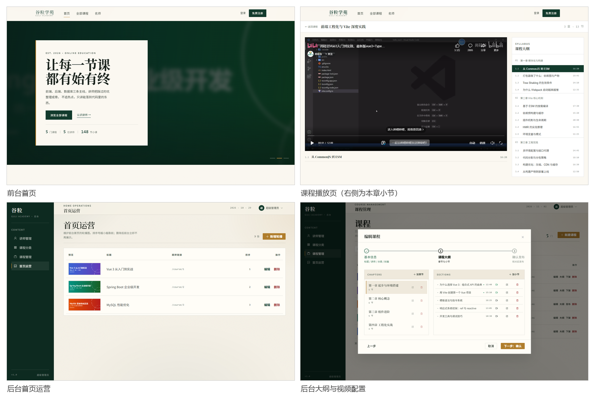

# 谷粒学苑 · 在线教育平台

基于 Spring Boot 4 + Vue 3 的前后端分离在线教育平台。覆盖讲师管理、课程分类、课程发布（三步向导）、首页运营、课程购买与在线播放的完整闭环，包含后台管理端与前台门户两套前端。

## 在线演示

| 入口 | 地址 |
|---|---|
| 前台门户 | http://122.51.6.69/ |
| 后台管理 | http://122.51.6.69/admin-ui/ |
| 接口文档 | http://122.51.6.69/swagger-ui.html |

> 演示环境的后台账号已改密，需要体验请自行注册学员账号。**支付为模拟实现**：点击「模拟支付」即视为成功，不接真实网关。

## 功能

**后台管理端**

- 管理员登录（JWT，令牌类型与前后台隔离）
- 讲师档案：增删改查、头像上传、被课程引用时禁止删除
- 课程分类：两级树形结构
- 课程发布：基本信息 → 大纲编排 → 确认发布三步向导，信息或大纲不完整时不允许发布
- 首页运营：轮播图维护（排序、OSS 图片上传）
- 大纲维护：章节/小节增删改，逐节配置 B 站视频链接

**前台门户**

- 首页（轮播、热门课程、名师）
- 课程列表与详情（分类筛选、大纲展示、分页）
- 讲师列表与详情
- 学员注册登录（手机号 + BCrypt）
- 课程购买：下单 → 模拟支付 → 解锁全部小节
- 在线播放：左侧视频区，右侧按章节分组的小节列表
- 我的课程

## 技术栈

| 层 | 选型 |
|---|---|
| 后端 | Spring Boot 4.1.1、JDK 21、MyBatis-Plus 3.5.17 |
| 数据库 | MySQL 8.0 |
| 认证 | JWT（jjwt 0.12）、BCrypt 密码加密 |
| 对象存储 | 阿里云 OSS（图片上传） |
| 后台前端 | Vue 3 + Element Plus + Vite |
| 前台前端 | Vue 3 + Vite（自研轻量组件，控制体积） |
| 接口文档 | springdoc-openapi |
| 部署 | Nginx + systemd（单机） |

## 快速开始

### 1. 数据库

```bash
mysql -u root -p -e "CREATE DATABASE guli DEFAULT CHARSET utf8mb4;"
mysql -u root -p guli < sql/init.sql
```

`sql/init.sql` 含 11 张表的建表语句、演示数据（6 门课程 / 21 章 / 100 节）与初始管理员账号。

### 2. 配置

```bash
cp src/main/resources/application-local.yml.example src/main/resources/application-local.yml
```

填入数据库连接与 OSS 配置。`application-local.yml` 已在 `.gitignore` 中，不会被提交。

生产环境通过环境变量覆盖敏感项：

```bash
export JWT_SECRET="生产环境请替换为随机长字符串"
export SPRING_DATASOURCE_PASSWORD="数据库密码"
```

### 3. 后端

```bash
mvn spring-boot:run -Dspring-boot.run.profiles=local

# 或打包部署
mvn clean package -DskipTests
java -jar target/guli-0.0.1-SNAPSHOT.jar
```

### 4. 前端

```bash
cd admin-web  && npm install && npm run dev   # 后台管理端
cd portal-web && npm install && npm run dev   # 前台门户
```

Windows 下可双击 `start-all.bat` 一键启动后端与两个前端。

## 项目结构

```
guli/
├── src/main/java/com/guli/
│   ├── controller/       # 后台 /admin/**、前台 /api/**、播放 /api/section/**
│   ├── service/impl/     # 业务逻辑，权限判定集中在 SectionPlayServiceImpl
│   ├── mapper/           # MyBatis-Plus Mapper
│   ├── entity/ dto/ vo/  # 数据模型分层
│   ├── common/           # 统一返回、异常、分页、登录上下文
│   ├── config/           # 拦截器、跨域、MyBatis-Plus、JWT 属性
│   └── util/             # JWT、OSS、B 站链接解析
├── admin-web/            # 后台管理端（Vue 3 + Element Plus）
├── portal-web/           # 前台门户（Vue 3）
├── sql/init.sql          # 建表 + 演示数据
├── deploy/               # Nginx 配置与部署脚本
└── docs/screenshots/     # 界面截图
```

## 几个值得说明的设计

**播放权限判定放在后端，且不返回播放地址。** 前端隐藏按钮只能防住不会用浏览器的人。`GET /api/section/{id}/play` 是唯一入口：免费课放行，付费课校验购买记录，不通过时只返回封面图，连播放地址都不下发。

**同一个 VO，按调用方决定字段可见性。** 后台大纲需要显示每节的视频链接供编辑，前台详情接口绝不能返回它。`listByCourse(courseId, includeVideo)` 用参数区分：后台传 `true`，前台走 `false`。这是服务端的保证，不是前端的自觉。

**拦截器分强制与可选两种模式。** `/admin/**`、`/api/order/**` 无令牌即拒绝；`/api/course/**`、`/api/section/**` 匿名可访问，但带令牌时会解析出身份，否则已付费学员会被当成游客。

**订单表存快照字段。** `course_title` 与 `cover` 是下单时的副本，课程改名换图后历史订单仍显示当时的名称。不建 `(member_id, course_id)` 唯一索引，因为允许取消后重新下单，判断是否已购靠 `status = 1` 查询。

**视频用 B 站官方播放器嵌入。** 自建视频要解决存储、转码、防盗链整条链路，成本远超项目范围。`edu_section` 只存一个链接，后端解析成受控的播放器地址；非法链接（非 bilibili.com、短链、`javascript:` 伪协议）在保存阶段就被拒绝。

## 界面



## 说明

本项目为软件工程课程实验作品，单体架构部署在单台云服务器上。支付环节为模拟实现，不涉及真实资金流转；视频内容来自 B 站公开资源，仅作教学演示。

## License

仅用于学习与教学演示。
