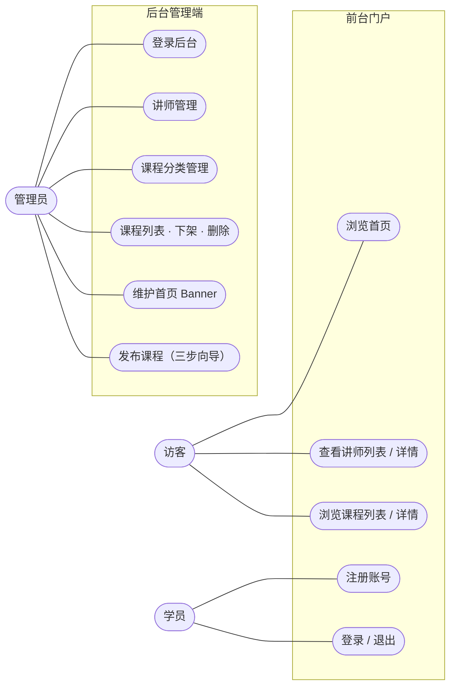
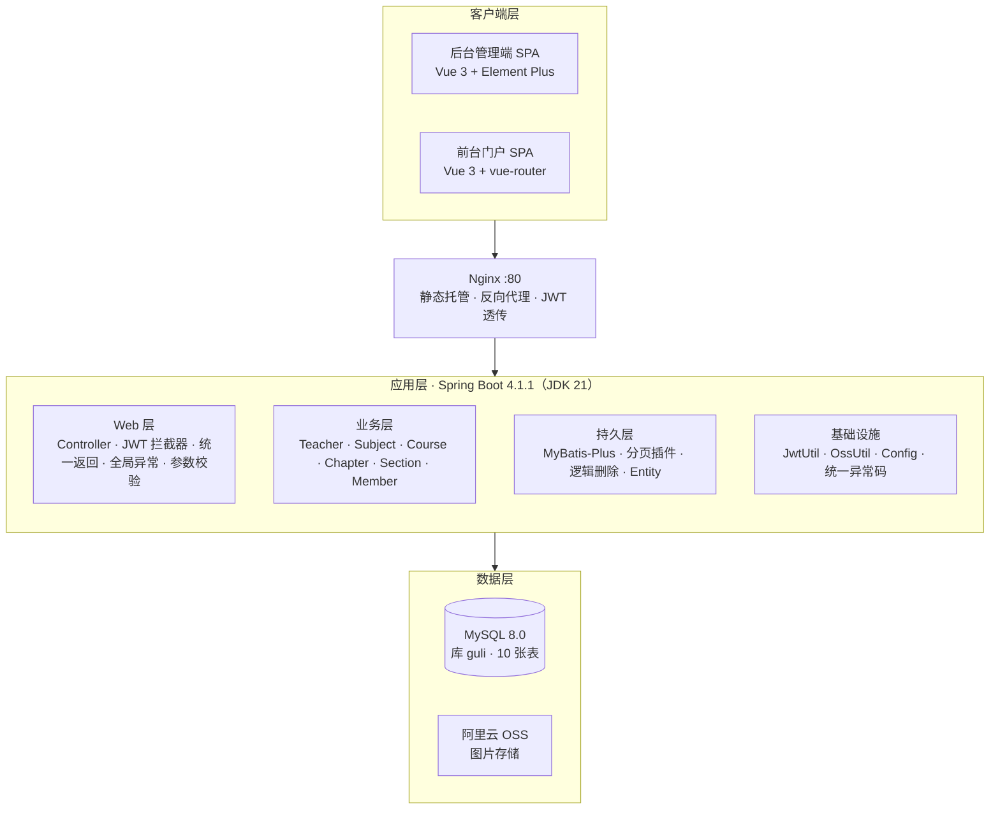
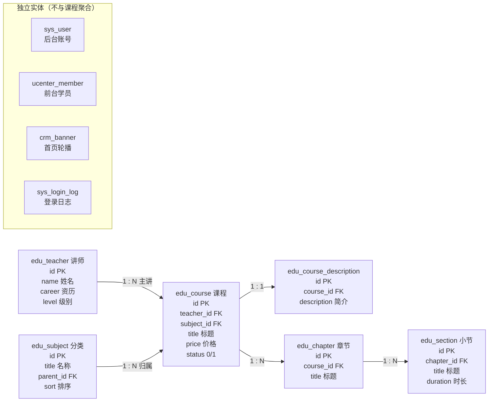
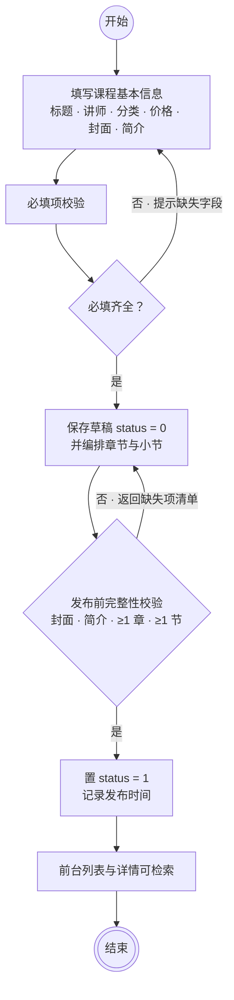
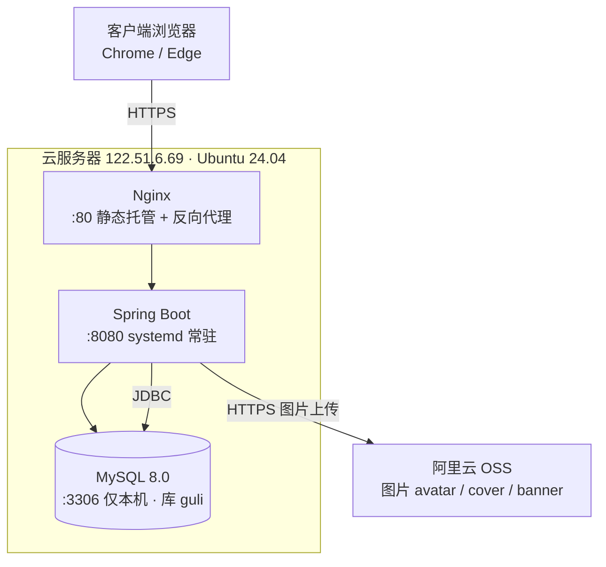

# WPS 流程图 · Mermaid 粘贴稿（5 张图）

> WPS 流程图的「导入流程图」弹窗第一栏就是 **粘贴 Mermaid 文本**。
> 用法：复制某一段代码（**不要带 ``` 这行**），粘进输入框 → 确定 → 生成图形 → 在 WPS 里拖一拖、换形状。
>
> ⚠️ **先说清楚它能做到什么**：Mermaid 由 dagre 自动排版，**我控制不了节点位置**。
> 导入后你会得到“内容完整、连线正确、但布局需要手动拖”的骨架。
> 其中 **用例图 / E-R 图** 出来的效果可直接用；**活动图 / 部署图** 偏窄长，需要在 WPS 里横向拉开。
>
> 如果你只想要“能直接插报告的图”，用 `out/preview_*.png`（2 倍高清）更快，不用在 WPS 里返工。

---

## 1. 用例图



> 粘完把 `Admin / Guest / Member` 三个节点换成 WPS 的**火柴人（参与者）**形状即可；
> 学员不连「浏览课程」，因为学员是访客的子集，浏览能力由访客一侧表达。

---

## 2. 体系结构图



---

## 3. E-R 图



---

## 4. 活动图 · 课程发布



> 纵向流程图。插入 Word 时按 **9cm 宽**排（高约 16cm），正好一页放得下。

---

## 5. 部署图



> 三层：浏览器 → 服务器（内部三件套横排）→ OSS。插入 Word 按 **14cm 宽**排。

---

## 如果 Mermaid 也失败

WPS 那三个入口的真实支持情况：

| 入口 | 说明 |
|---|---|
| **粘贴 Mermaid 文本** | 最稳，纯文本解析，不涉及文件格式校验 |
| 上传 POS / POSF | WPS 自家的流程图格式（ProcessOn 系），我们没有这个格式的生成器 |
| 上传 Visio | 大概率只吃旧版 `.vsd`（97-2003 二进制），**不吃 `.vsdx`**；这就是你传不上去的原因 |

所以顺序是：**先试英文名的 vsdx**（`vsdx/usecase.vsdx` 等，中文文件名也可能是上传失败原因）→ 不行就 **粘 Mermaid** → 都不行再照 `out/preview_*.png` 手动摆。

## 导出注意

- WPS 导出图片默认可能是 1x，贴进 Word 会糊：导出时选 **2x / 高清 / 300dpi**
- 导出完可以再「另存为 Visio」，手上就有 `.vsdx` 源文件，答辩问起来有交代
